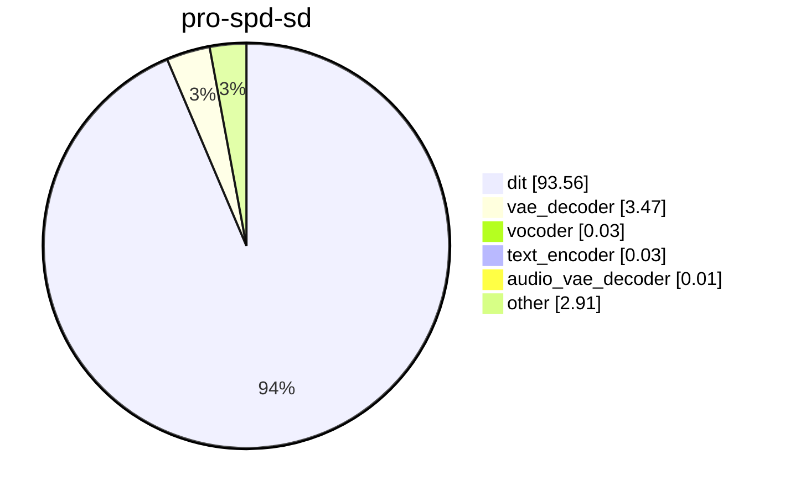
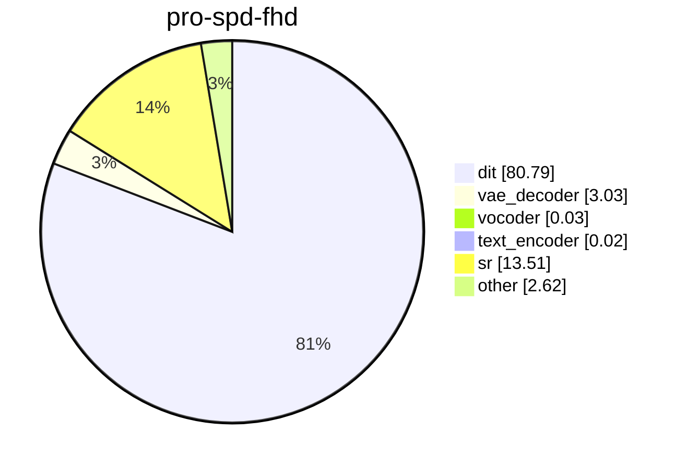

# SPEED acceleration on H100

Run `bench_2026-11-08T19-43-16` (SD) and `bench_2026-11-08T19-44-33` (FHD) on NVIDIA H100 80GB HBM3.

This is `just bench --only pro-{sd,fhd} --accel spd`. On top of the baseline `pro-{sd,fhd}` cell (Attention FlashAttention 3, Qwen BF16, Compile torch, MagCache from the checkpoint file, module offload), [SPEED](https://arxiv.org/abs/2605.18736) is deep-merged via [configs/accelerations/spd.yaml](../../configs/accelerations/spd.yaml): the denoising loop becomes staged at spatial scales `(1.0, 0.5, 1.0)` with transition flow times `(0.99, 0.92)`. The base clip is 480×864 with audio. Full HD super-resolves that clip with the distilled 2-step VSR model at scale 2.25. Each cell is 3 generations (2 kept for the FHD cell after an offload-block OOM on the 3rd attempt); the reported time is the median.

The baseline column is `pro-sd` and `pro-fhd` from [h100.md](h100.md) (`bench_2026-10-20T20-54-28`), same configuration except `speed.enabled: false`.

## Charts

### Pro SPD

## Share of total time, %

| run | s | baseline s | Δ | offload | dit | vae_decoder | text_encoder | vocoder | audio_vae_decoder | sr | other |
| --- | ---: | ---: | ---: | --- | ---: | ---: | ---: | ---: | ---: | ---: | ---: |
| pro-spd-sd | 302.1 | 351.5 | &minus;14.1% | module | 93.6 | 3.47 | 0.03 | 0.03 | &lt;0.01 | 0 | 2.91 |
| pro-spd-fhd | 341.8 | 399.7 | &minus;14.5% | module | 80.8 | 3.03 | 0.02 | 0.03 | &lt;0.01 | 13.5 | 2.62 |

The savings come entirely from DiT: at scale 0.5 the middle stage runs on ~¼ of the full-resolution token count, cutting ~50 s from the DiT budget. VAE, text, vocoder, and SR times are unchanged. Module peak is 78.2 GB — the same offload ladder as the baseline settles on `module`.
